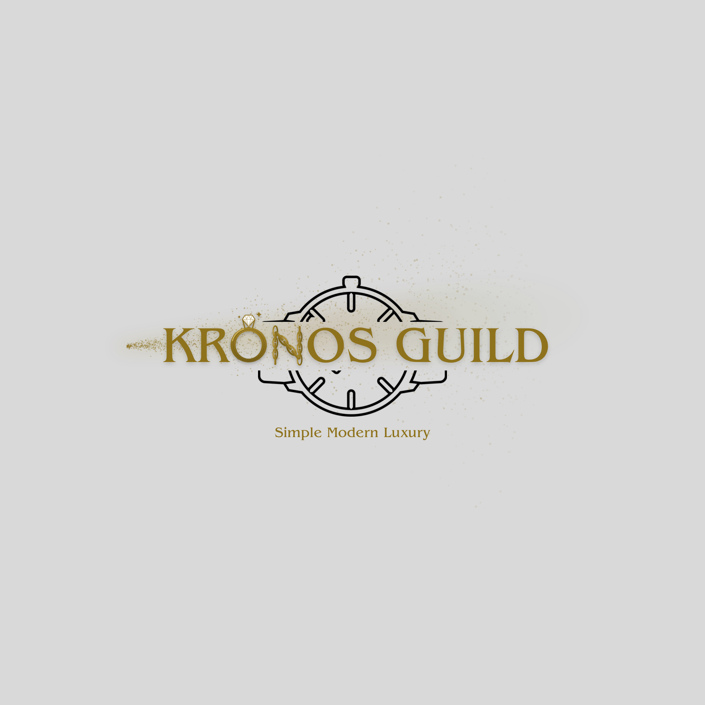

# Kronos Guild — Logo

The original logo is kept exactly as it was: same watch, same colors, same tagline, and the name **KRONOS GUILD** in the same font and position. Three touches were added for the new jewelry and perfume lines:

- **First O in KRONOS is now a ring.** It's a gold band with a diamond on top and two small sparkles.
- **The N is now a gold chain.** The two sides and the diagonal are made of chain links, so it still reads as an N.
- **A little gold perfume bottle stands to the left of the K.** It has an atomizer pump and sits on the same baseline as the letters.
- **The perfume spray comes out of that bottle's nozzle.** It's a fine gold mist that spreads to the right behind the name. It stays behind the letters and the watch.

## Files
| File | |
| --- | --- |
| `kronos-guild-logo.png` | New logo (2000×2000) |
| `kronos-guild-logo-no-spray.png` | Ring, chain and bottle, no spray (small sizes, stamps, embroidery) |
| `original/kronos-guild-original.png` | The original logo, for reference |

## Reveal video
A 10.5-second animation that goes from the original logo to the new one. It comes in three sizes, so it fits any screen:

| File | Best for |
| --- | --- |
| `video/kronos-guild-reveal-square-1080x1080.mp4` | Instagram and Facebook feed posts |
| `video/kronos-guild-reveal-vertical-1080x1920.mp4` | Stories, Reels, TikTok and WhatsApp status |
| `video/kronos-guild-reveal-landscape-1920x1080.mp4` | Website, YouTube and screens in the shop |

What happens in the video:
1. The original logo fades in.
2. The other letters shake a little while the old **O** and **N** float up and fade away. The **ring** and the **chain N** rise into place from below, and the diamond sparkles.
3. The perfume bottle enters from the right side of the screen. It spins on itself while it circles behind the logo, then lands in its place next to the K.
4. The bottle's pump presses down and the gold mist sprays out behind the name. The diamond sparkles once more and the final logo holds on screen.

## Product images
`kronos-guild-logo-dark-transparent.png` is the logo with a transparent background. The watch outline is light, so the logo works on dark backgrounds.

### CURREN 8443 — Chronographe Rouge
Product images for kronosguild.shop, in French, 1500×1500 JPG. They are in `produits/curren-8443-rouge/`.

| File | Content |
| --- | --- |
| `01-curren-8443-rouge-couverture.jpg` | Cover: logo, title, main features |
| `02-curren-8443-rouge-caracteristiques.jpg` | Features with pointers: Hardlex glass, chronograph, luminous hands, date |
| `03-curren-8443-rouge-fiche-technique.jpg` | Full spec sheet |
| `04-curren-8443-rouge-details.jpg` | Stainless steel case back, textured strap, adjustable strap |
| `05-curren-8443-rouge-photo-principale.jpg` | Clean photo with no text, for the main thumbnail or Google Shopping |
