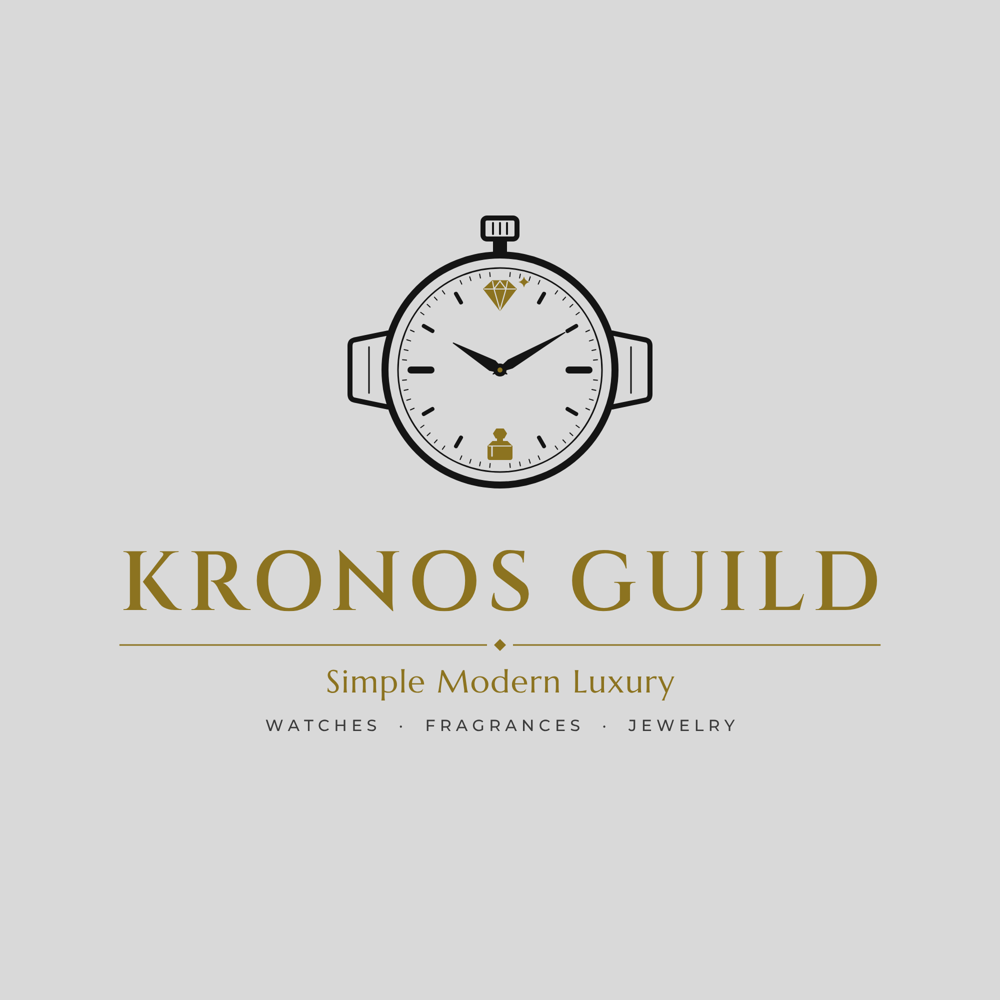

# Kronos Guild — Logo

Redesigned mark for Kronos Guild as the brand grows from men's watches into **fragrances** and **jewelry**.

## What changed
- **The watch stays at the center.** It's still a watch with a crown, case, strap lugs and hands set to 10:10, so the brand's watch roots stay clear.
- **12 o'clock is now a cut diamond** (with a small sparkle). This stands for **jewelry**.
- **6 o'clock is now a faceted perfume bottle.** This stands for **fragrances**.
- Both new touches are in brand gold. The rest of the watch stays black, so the new lines show without being loud.
- The name **KRONOS GUILD** is unchanged. It now sits below the emblem instead of being cut through it, which makes it easier to read. Below the name is a thin divider, the tagline *Simple Modern Luxury*, and a quiet category line: `WATCHES · FRAGRANCES · JEWELRY`.

## Files
| File | Use |
| --- | --- |
| `svg/kronos-guild-logo.svg` / `png/…` | Main logo, light grey background |
| `svg/kronos-guild-logo-dark.svg` / `png/…` | Black and gold version (packaging, social media, store signage) |
| `svg/kronos-guild-logo-transparent.svg` / `png/…` | Main logo with no background |
| `svg/kronos-guild-emblem*.svg` / `png/…` | Emblem only (profile picture, favicon, stamp on boxes and bottles) |

All text is converted to outlines, so the SVGs look the same everywhere with no fonts installed.
Fonts used: Cinzel SemiBold (name), Marcellus (tagline), Montserrat Medium (categories).

## Colors
| | Light | Dark |
| --- | --- | --- |
| Gold | `#8C7320` | `#C9A646` |
| Lines | `#141414` | `#E9E2CF` |
| Background | `#D9D9D9` | `#0E0E0E` |
